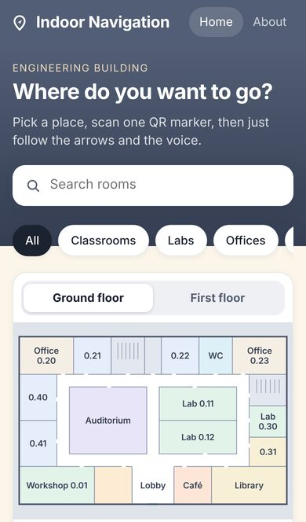
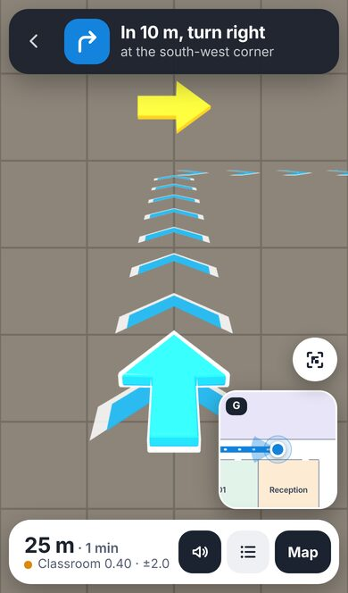
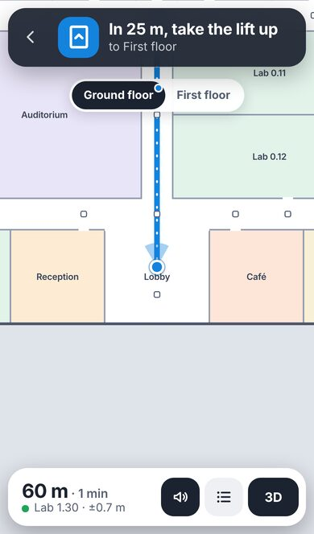
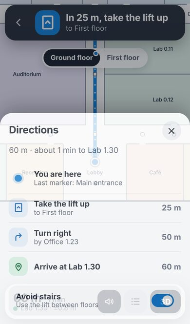
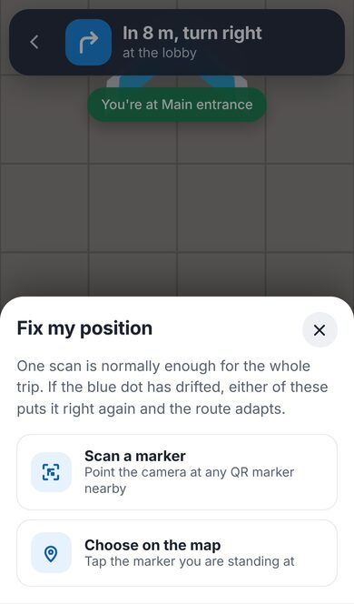
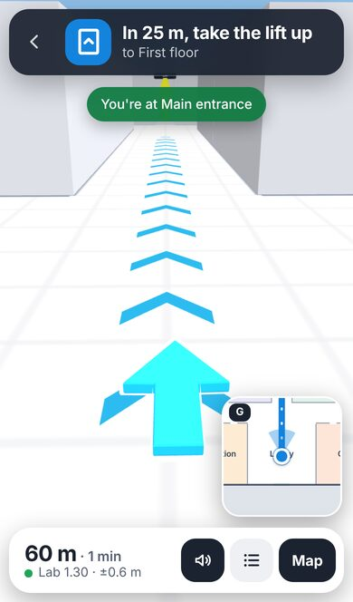
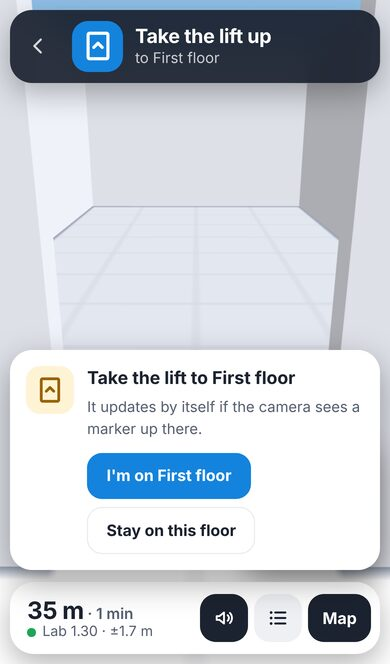

# Indoor-Navigation

Indoor navigation that runs in a plain mobile browser. The building only needs printed QR codes: the
phone's camera reads **one** marker to find out where the user is and which way they face; from then on
the position is tracked with the phone's motion sensors, while arrows over the live camera image, a live
floor plan and spoken directions lead to the destination.

Rust + WebAssembly (QR detection with `rqrr`, camera pose with the Lambda Twist PnP solver), React +
TypeScript, Three.js for the AR overlay, Dijkstra for routing. No backend, no GPS, no app install.

- [What it does](#what-it-does)
- [Do I have to scan every marker?](#do-i-have-to-scan-every-marker)
- [Run it](#run-it)
- [Try it on a phone](#try-it-on-a-phone)
- [Deploy](#deploy)
- [The building](#the-building)
- [Voice and sounds](#voice-and-sounds)
- [Tests](#tests)
- [Project layout](#project-layout)
- [What has and has not been verified](#what-has-and-has-not-been-verified)

More detail on how it works: [docs/ARCHITECTURE.md](docs/ARCHITECTURE.md).

## What it does

1. Open the site and pick a destination: search, filter by category, or tap a room on the floor plan.
2. Tap **Start camera navigation** and point the camera at the nearest QR marker. One scan.
3. Hold the phone up and walk. Arrows on the camera image show the way, a banner and a voice announce the
   next turn, the map shows where you are. Leaving the route produces a new one; reaching the stairs or
   the lift asks for the floor change; arriving ends the trip.

**Try a simulated walk** on the same screen plays the whole thing as a 3D walk-through of the building,
without a camera (also handy on a desktop).

| Choose | Scan once | Follow the arrows | Map |
|---|---|---|---|
|  |  |  |  |

| Directions | Fix my position | 3D walk-through | Another floor |
|---|---|---|---|
|  |  |  |  |

(Screenshots from the automated end-to-end run: the "camera image" is the test's synthetic floor.)

| | |
|---|---|
| Position | QR marker pose (exact) → step counting + heading from the motion sensors, matched to the corridor graph |
| Heading | from the way the marker appears in the image; kept by the gyroscope, corrected along straight corridors |
| Routing | Dijkstra, recomputed from wherever the user is; several floors; optional step-free routes |
| Map | vector floor plan (rooms, corridors, doors) drawn as SVG; pan, zoom, tap a room |
| AR | Three.js scene over the camera image; optional WebXR mode where the browser offers it |
| Audio | conversational spoken directions with the most natural voice on the device, soft sound cues |
| Fallbacks | no motion sensors → scan each marker (the original behaviour); no camera → pick the start on the map; no WebGL → banner and map only |

## Do I have to scan every marker?

No. Scanning the first marker is enough for the whole trip.

- The first scan gives the exact position and, from the way the code appears in the image, the direction
  the user is facing.
- After that every step and every turn is tracked with the motion sensors and matched to the corridors
  of the building. A turn taken at a junction snaps the estimate onto that junction, which removes the
  distance error collected so far, so the estimate stays good over long routes.
- The camera keeps looking in the background. A marker that happens to pass through its view corrects
  the position silently; nobody has to aim at it.
- If the estimate has drifted anyway (the blue dot is not where you are), **Fix my position** offers two
  ways out: scan any marker on purpose, or tap your position on the map. The route adapts from there.
- The app only suggests a scan by itself when its accuracy estimate has become poor (about 5 m). The
  test that walks the longest kind of route in the demo building (about 70 m, five turns, one staircase)
  from a single scan never gets there.

The one exception is a phone that exposes no motion sensors to the browser: without them nothing can be
tracked between markers, so the app says so and falls back to scanning the markers on the way.

## Run it

You need `node` and `npm`. The compiled WebAssembly module is committed (`react-client/public/wasm`), so
Rust is only needed to change the Rust code.

```bash
cd react-client
npm install
npm start
```

Then open `http://localhost:3000`.

Production build:

```bash
npm run build
```

### Rust code

Needs the Rust toolchain with the `wasm32-unknown-unknown` target and `wasm-pack`:

```bash
rustup target add wasm32-unknown-unknown
cargo install wasm-pack
```

Rebuild the WebAssembly module (writes to `react-client/public/wasm`):

```bash
cd react-client
npm run build:wasm
```

Rust unit tests:

```bash
cd wasm
cargo test
```

## Try it on a phone

Browsers only give a page the camera and the motion sensors on a **secure origin**. `localhost` counts,
a LAN address over plain `http` does not. Two easy options:

- a tunnel (the thesis used ngrok): `ngrok http 3000`, open the `https://…` address on the phone;
- the dev server's own HTTPS: `HTTPS=true npm start`, open `https://<computer-ip>:3000` and accept the
  self-signed certificate.

On iPhone the first tap on *Start camera navigation* asks for motion-sensor access as well as the camera.

Print a few markers from `QRCodeImages/`, lay them on the floor **all with the same edge pointing to the
top of the map** (the sheets say which edge), and make the building data match where you put them.

## Deploy

The app is a static site and needs HTTPS (for the camera and motion sensors); both free options below
provide it.

**GitHub Pages** (`.github/workflows/deploy-pages.yml`). Once: *Settings → Pages → Build and deployment →
Source: GitHub Actions*. Every push to the default branch then runs the tests, builds the client for
the `/<repository>/` sub-path and publishes it at `https://<user>.github.io/<repository>/`. It can also
be started by hand from the *Actions* tab.

**Vercel** (`vercel.json`). Import the repository at vercel.com with the default settings; the file tells
Vercel how to build `react-client` and to serve `index.html` for deep links. Every branch gets its own
preview URL.

Any other static host works too: run `npm run build` in `react-client` (set `PUBLIC_URL=/sub/path` if the
site is not served from the root), upload `react-client/build`, and make unknown paths fall back to
`index.html`.

## The building

Everything about the building lives in `react-client/src/db/graph.json`, the JSON "database" of the
thesis, extended. It holds two things:

- the **graph**: nodes (QR markers at doors and junctions) with weighted links between them, as before;
- the **floor plan** as vector data: per floor, the rooms (rectangles with a kind, a name and door
  positions) and the corridor areas. The 2D map and the 3D walk-through are both drawn from it, which is
  what lets rooms be tapped, highlighted and labelled, and keeps the map sharp at any zoom.

```jsonc
{
  "meta": {
    "name": "Engineering Building",
    "metersPerUnit": 0.1,           // one map unit is 10 cm
    "qrSize": 0.18,                 // printed side length of the codes, metres
    "floors": [{
      "id": 0, "name": "Ground floor", "short": "G", "spoken": "the ground floor",
      "width": 640, "height": 400,
      "corridors": [{ "x": 90, "y": 90, "w": 460, "h": 30 }],
      "rooms": [{
        "id": "cafe", "name": "Café", "short": "Café", "kind": "cafe",
        "x": 370, "y": 310, "w": 90, "h": 90,
        "doors": [{ "x": 395, "y": 310 }],   // centre of the door on the room's wall
        "node": 3                            // the marker in front of that door
      }]
    }]
  },
  "nodes": [{
    "id": 3, "name": "G04", "type": "room",        // "room" = destination, "node" = junction, "stairs", "elevator"
    "x": 395, "y": 295, "floor": 0,
    "label": "Café", "room": "cafe",
    "path": [
      { "nodeID": 1, "weight": 7.5 },                 // neighbour and routing cost (metres)
      { "nodeID": 20, "weight": 5 }
    ]
  }]
}
```

Room kinds with their own colour and icon: `classroom`, `auditorium`, `lab`, `office`, `library`, `study`,
`cafe`, `restroom`, `reception`, `lobby`, `stairs`, `elevator`. Links between floors carry
`"kind": "stairs"` or `"elevator"` and a `"length"`.

**About the shipped building.** No floor plan of a real building was available for this work, so the
demo is a *designed* one: a to-scale two-storey teaching building of 64 m × 40 m, with rooms around a
3 m ring corridor, a central block (auditorium, labs) split by a cross corridor that lines up with the
main entrance, two staircases, a lift, restrooms, a café, a library and a reception. It is realistic in
its dimensions and layout, but it is not a survey of an existing building. It is generated by
`react-client/scripts/build-demo-building.js`.

**Using a real building.** Trace its plan into the same structure (rooms as rectangles in a coordinate
system of your choice, `metersPerUnit` giving the scale), put a node in the corridor in front of each
door and at each junction, and link neighbouring nodes along the corridor centre lines. Either edit
`graph.json` directly or adapt the tables in the generator script. A scanned plan can be shown under the
vector layer while tracing: set `"map": "file.png"` on the floor and register the image in
`src/assets/maps.ts`. Then print the markers:

```bash
cd react-client
npm run markers
```

Pass `-- --base https://your.host` to put your address in the codes and `-- --format at` for codes that,
scanned with the phone's own camera app, open the destination list with the start position known. The
payload format `…/qrScanner/<id>` is the original one, so `local0.pdf … local3.pdf` still decode to
valid markers (ids 0–3 are the entrance, the lobby, the reception and the café of the demo building).

## Voice and sounds

**Speech.** A web page without a server cannot ship its own recorded or neural voice, so the app speaks
through the browser's speech synthesis, and what it sounds like depends on the voices installed on the
device. Those range from very natural to plainly robotic, and the browser's default is often not the
best one. The app therefore ranks the available voices (natural / neural / enhanced ones first, known
novelty and first-generation voices last), uses the best, and lets the user choose another under
**Sound → Voice**, with a sample button. For the most natural result install an enhanced voice in the
system's speech settings (iOS: *Accessibility → Spoken Content → Voices*; Android: Google's speech
services; Windows/Edge and Chrome desktop already offer natural voices).

What is said is written to be heard, not read: full sentences, distances rounded the way people say them
("in about ten metres"), room numbers read as people read them, landmarks instead of marker codes
("turn left, at the lobby"), the side the door is on at arrival. Each thing is said once: a heads-up
before a turn, a short prompt at the turn, a word when the route or the floor changes.

**Sounds.** Seven short effects are synthesised with the Web Audio API (no audio files): soft bell-like
tones from one pentatonic set with a quick but click-free attack, a natural decay and a touch of echo.
Start (two notes up), turn (one clear note, panned to the side of the turn), marker passed (a faint
tick), route changed (two notes down), wrong way (two low pulses), floor change, arrival (a small
arpeggio).

**Manners.** One thing at a time; a sound introduces its sentence and the sentence starts when the sound's
body is over. A sentence is never cut off by something of equal or lower priority, only by something more
important (wrong way, arrival). Prompts that waited too long are dropped. The marker tick is skipped
while anything else plays and is limited to once every eight seconds. **Sound** in the bottom bar
switches between voice + sounds, sounds only and silent; the choice is remembered.

## Tests

```bash
cd react-client
npm test              # unit + component tests
npm run build && npm run test:e2e    # end-to-end in a mobile-emulated Chromium
```

The end-to-end test needs the `playwright` package (`npm i -D playwright && npx playwright install chromium`).
It feeds the app a fake camera showing the printed markers, synthetic motion-sensor events and a recording
speech synthesiser, so the real pipeline runs: frame → WebAssembly detection and pose → fix → step
tracking → routing → guidance → AR and audio. Pass a directory to keep screenshots:
`node e2e/navigation.e2e.js ./shots`.

## Project layout

```
wasm/                      Rust crate compiled to WebAssembly
  src/lib.rs               scan_frame (raw pixels → codes + pose), legacy decode_qr
  src/camera_pose_est.rs   Lambda Twist + ARRSAC pose of a QR code, with refinement
react-client/
  public/qr-worker.js      Web Worker that runs the WebAssembly scanner
  public/wasm/             built WebAssembly module (committed)
  src/db/graph.json        the building: graph + vector floor plan
  src/db/dijkstra.ts       shortestPathF (original API) on top of the new router
  src/nav/                 pure logic: building model, routing, instructions, orientation maths,
                           QR pose interpretation, step detector, tracker, navigation session,
                           announcer (what to say and when), simulator
  src/audio/               sound effects (Web Audio), voice selection and speech, playback queue
  src/map/plan.ts          how a floor plan is drawn (shared by the SVG map and the 3D scene)
  src/sensors/             camera, frame scanner, motion sensors
  src/ar/ArScene.ts        Three.js overlay and 3D walk-through (also drives the WebXR mode)
  src/components/          HomePage, QrScanner (navigation screen), ArView, MapView, NavPanels, About
  e2e/                     end-to-end test and its static server
  scripts/                 build-demo-building.js, generate-markers.js
QRCodeImages/              printable markers
docs/ARCHITECTURE.md
```

## What has and has not been verified

Verified here, automatically: the Rust unit tests (9), the unit/component tests (84) and seven
end-to-end scenarios in a mobile-emulated Chromium:

1. choosing a destination on the floor plan;
2. **one scan at the entrance, then only walking** through two turns to a classroom, with the spoken
   sentences, their order, the absence of overlaps and repetitions, the chosen voice and the sound cues
   all checked, and every sound effect rendered and measured (level, length);
3. recovering from a wrong position by re-scanning and by tapping the map;
4. no motion sensors (scan each marker);
5. camera refused;
6. a step-free trip to the first floor by lift in the 3D walk-through;
7. the WebXR mode against a scripted XR device.

**Not** verified, because no phone, building or loudspeaker was available during this work:

- **A physical phone in a physical building.** A few numbers are informed defaults rather than
  measurements and are the first things to tune on real hardware: the step detection threshold and step
  length model (`src/nav/stepDetector.ts`; the step length also adapts between markers at run time), the
  assumed camera field of view (`estimateFocalPx` in `src/nav/qrPose.ts`) and the eye height of the
  overlay (`EYE_HEIGHT` in `src/ar/ArScene.ts`).
- **How it sounds.** The sound effects were designed from first principles and checked numerically, and
  the speech was checked as text; nobody has listened to either. The levels, pitches and the speaking
  rate (`src/audio/sounds.ts`, `rate` in `src/audio/voice.ts`) may want adjusting by ear. How natural the
  voice is depends on the device, as explained above.
- **WebXR on a real device.** "Precise AR (beta)" is shown only where the browser reports
  `immersive-ar` support (Chrome on ARCore phones) and has only been exercised with a simulated XR device.
  Markers cannot be scanned while it runs, because the XR session owns the camera.

Development note: the ejected create-react-app toolchain in this repository lints with an old TypeScript
parser that cannot read tuple types (`[number, number]`); use `number[]` in `src/`.
