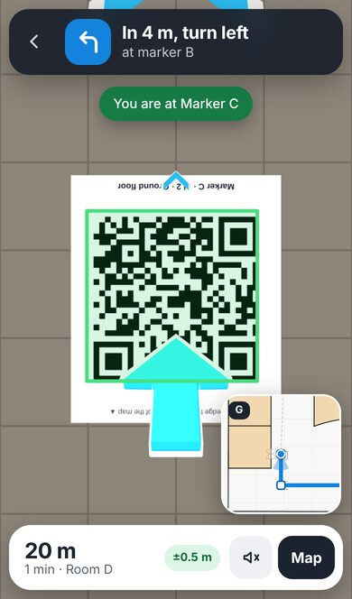

# Indoor-Navigation

Indoor navigation that runs in a plain mobile browser. The building only needs printed QR codes: the
phone's camera reads a marker to find out where the user is and which way they face, and from then on the
position is tracked with the phone's motion sensors while arrows drawn over the live camera image lead to
the destination.

Rust + WebAssembly (QR detection with `rqrr`, camera pose with the Lambda Twist PnP solver), React +
TypeScript, Three.js for the AR overlay, Dijkstra for routing. No backend, no GPS, no app install.

- [What it does](#what-it-does)
- [Run it](#run-it)
- [Try it on a phone](#try-it-on-a-phone)
- [Set it up for a real building](#set-it-up-for-a-real-building)
- [Tests](#tests)
- [Project layout](#project-layout)
- [What has and has not been verified](#what-has-and-has-not-been-verified)

More detail on how it works: [docs/ARCHITECTURE.md](docs/ARCHITECTURE.md).

## What it does

1. Open the site, pick a destination.
2. Tap **Start camera navigation** and point the camera at the nearest QR marker. One scan is enough.
3. Hold the phone up and follow the arrows. A banner announces the next turn, a small map shows the position.
4. Markers that happen to pass through the camera's view while walking correct the position silently.
   Leaving the route produces a new one; reaching the stairs asks for the floor change; arriving ends the trip.

**Try a simulated walk** on the same screen plays the whole thing without a camera (also handy on a desktop).

| Choose | Scan once | Follow the arrows | Map |
|---|---|---|---|
|  |  |  |  |

(Screenshots from the automated end-to-end run: the "camera image" is the test's synthetic floor.)

| | |
|---|---|
| Position | QR marker pose (exact) → step counting + heading from the motion sensors, matched to the corridor graph |
| Heading | from the way the marker appears in the image; kept by the gyroscope, re-calibrated at every marker and along straight corridors |
| Routing | Dijkstra, recomputed from wherever the user is; several floors |
| AR | Three.js scene over the camera image; optional WebXR mode where the browser offers it |
| Fallbacks | no motion sensors → scan each marker (the original behaviour); no camera → pick the start on the map; no WebGL → banner and map only |

## Run it

You need `node` and `npm`. The compiled WebAssembly module is committed (`react-client/public/wasm`), so
Rust is only needed to change the Rust code.

```bash
cd react-client
npm install
npm start
```

Then open `http://localhost:3000`.

Production build:

```bash
npm run build
```

### Rust code

Needs the Rust toolchain with the `wasm32-unknown-unknown` target and `wasm-pack`:

```bash
rustup target add wasm32-unknown-unknown
cargo install wasm-pack
```

Rebuild the WebAssembly module (writes to `react-client/public/wasm`):

```bash
cd react-client
npm run build:wasm
```

Rust unit tests:

```bash
cd wasm
cargo test
```

## Try it on a phone

Browsers only give a page the camera and the motion sensors on a **secure origin**. `localhost` counts,
a LAN address over plain `http` does not. Two easy options:

- a tunnel (the thesis used ngrok): `ngrok http 3000`, open the `https://…` address on the phone;
- the dev server's own HTTPS: `HTTPS=true npm start`, open `https://<computer-ip>:3000` and accept the
  self-signed certificate.

On iPhone the first tap on *Start camera navigation* asks for motion-sensor access as well as the camera.

Print a few markers from `QRCodeImages/`, lay them on the floor **all with the same edge pointing to the
top of the map** (the generated sheets say which edge), and edit `react-client/src/db/graph.json` so the
node coordinates and `meta.metersPerUnit` match where you put them.

## Set it up for a real building

Everything about the building lives in `react-client/src/db/graph.json` (the JSON "database" of the
thesis, extended; old files still load):

```jsonc
{
  "meta": {
    "name": "Demo building",
    "metersPerUnit": 0.1,          // size of one map unit in metres: needed to turn steps into map distance
    "qrSize": 0.18,                // printed side length of the codes, metres
    "floors": [{ "id": 0, "name": "Ground floor", "short": "G", "map": "map.png", "width": 300, "height": 300 }]
  },
  "nodes": [
    {
      "id": 0, "name": "A", "type": "room",       // "room" = destination, "node" = waypoint, "stairs" / "elevator"
      "x": 155, "y": 260, "floor": 0,             // position on the floor's map
      "label": "Reception",                       // optional display name
      "qr": { "mount": "floor", "rotation": 0 },  // optional; "wall" + "facing" for wall markers, false for no marker
      "path": [
        { "nodeID": 1, "weight": 9 },             // neighbour and routing cost (use metres)
        { "nodeID": 12, "weight": 12, "kind": "stairs", "length": 8 }
      ]
    }
  ]
}
```

- Edges should be straight walkable lines (corridor centre lines); the tracker assumes the user is on one of them.
- Floor plan images go in `react-client/src/assets/` and are registered in `assets/maps.ts`.
- `npm run markers` (in `react-client`) writes a printable SVG marker for every node to `QRCodeImages/`.
  Pass `-- --base https://your.host` to put your address in the codes and `-- --format at` for codes
  that, scanned with the phone's own camera app, open the destination list with the start position known.
  The original `local0.pdf … local3.pdf` remain valid: the payload format `…/qrScanner/<id>` is unchanged.

The shipped graph is a demo: the five original nodes (A–E, same ids and coordinates as the printed
codes), the remaining marker positions drawn on the floor plan (F–L), and a small second floor (N–R)
that reuses the same plan to exercise stairs. Weights are in metres under an assumed scale of 0.1 m per
map unit. Replace it with your building.

## Tests

```bash
cd react-client
npm test              # unit + component tests (routing, tracking, QR pose maths, UI)
npm run build && npm run test:e2e    # end-to-end in a mobile-emulated Chromium
```

The end-to-end test needs the `playwright` package (`npm i -D playwright && npx playwright install chromium`).
It feeds the app a fake camera showing the printed markers and synthetic motion-sensor events, so the real
pipeline runs: frame → WebAssembly detection and pose → fix → step tracking → routing → guidance → AR.
Pass a directory to keep screenshots: `node e2e/navigation.e2e.js ./shots`.

## Project layout

```
wasm/                      Rust crate compiled to WebAssembly
  src/lib.rs               scan_frame (raw pixels → codes + pose), legacy decode_qr
  src/camera_pose_est.rs   Lambda Twist + ARRSAC pose of a QR code, with refinement
react-client/
  public/qr-worker.js      Web Worker that runs the WebAssembly scanner
  public/wasm/             built WebAssembly module (committed)
  src/db/graph.json        the building
  src/db/dijkstra.ts       shortestPathF (original API) on top of the new router
  src/nav/                 pure logic: building model, routing, instructions, orientation maths,
                           QR pose interpretation, step detector, tracker, navigation session, simulator
  src/sensors/             camera, frame scanner, motion sensors
  src/ar/ArScene.ts        Three.js overlay (also drives the WebXR mode)
  src/components/          HomePage, QrScanner (navigation screen), ArView, MapView, About
  e2e/                     end-to-end test and its static server
  scripts/generate-markers.js
QRCodeImages/              printable markers
docs/ARCHITECTURE.md
```

## What has and has not been verified

Verified here, automatically: the Rust unit tests (9), the unit/component tests (53) and five
end-to-end scenarios in a mobile-emulated Chromium — one scan then walking with turns, re-calibration at
a passing marker and arrival; navigation with no motion sensors; camera refused; a two-floor trip in demo
mode; and the WebXR mode against a scripted XR device.

**Not** verified: a physical phone in a physical building. No such device was available during this
work, so a few numbers are informed defaults rather than measurements and are the first things to tune on
real hardware:

- step detection threshold and step length model (`src/nav/stepDetector.ts`; the step length also adapts
  between markers at run time);
- the assumed camera field of view (`estimateFocalPx` in `src/nav/qrPose.ts`), which scales the measured
  distance to a marker and how well floor arrows line up with the real floor;
- the eye height used for the overlay (`EYE_HEIGHT` in `src/ar/ArScene.ts`).

The WebXR mode ("Precise AR (beta)", shown only where the browser reports `immersive-ar` support,
i.e. Chrome on ARCore phones) has only been exercised with a simulated XR device. Markers cannot be
scanned while it runs, because the XR session owns the camera.

Development note: the ejected create-react-app toolchain in this repository lints with an old TypeScript
parser that cannot read tuple types (`[number, number]`); use `number[]` in `src/`.
